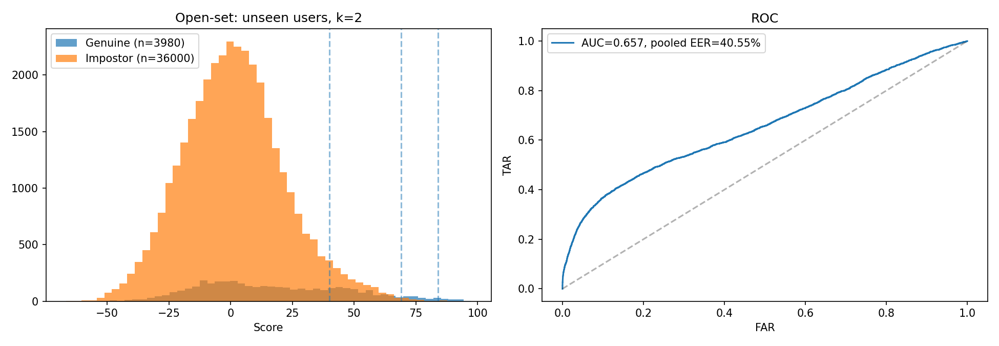

<div align="center">

# 👻 GhostID

### Continuous Keystroke-Dynamics Verification with Metric Learning

**An ArcFace-trained LSTM encoder, evaluated open-set against classical baselines, packaged as a drop-in session-verification service.**

[](https://github.com/yogeshroyal63-beep/GhostId/actions)
[](LICENSE)


[Abstract](#abstract) · [Results](#results) · [Method](#method) · [Protocol](#evaluation-protocol) · [Reproduce](#reproducing-the-results) · [Limitations](#limitations) · [System](#system-implementation) · [Deploy](#deployment)

[Live demo](https://ghost-id-rho.vercel.app)

</div>

---

## Abstract

Session tokens prove who logged in, not who is typing now. GhostID verifies identity continuously from keystroke timing alone, with no camera, OTP, or user action. We train a 2-layer LSTM encoder with an ArcFace angular-margin loss on the CMU keystroke dynamics benchmark (51 typists, 400 password repetitions each) and score a live sample by cosine similarity to an enrolled embedding centroid. Unlike the common closed-set evaluation, we also report **open-set** results on typists the model never saw in training, compare against three classical detectors (Euclidean, Scaled Manhattan, shrinkage Mahalanobis), and ablate the loss function and feature set.

On enrolled users the model reaches a mean per-user EER of **3.09%** (AUC 0.989). On **unseen** users the picture is much harder: with 2 enrollment samples the EER is **32.3%**, worse than Scaled Manhattan (25.9%); the encoder only overtakes the classical baselines at 50 enrollment samples (15.6% vs. 17.7%). Replacing ArcFace with a plain softmax loss improves open-set EER to **10.5%** at k=50, the best result we measured. The encoder runs in **0.18 ms** per query on CPU.

> All numbers below are produced by [`ml/notebooks/ghostid_v4_evaluation.ipynb`](ml/notebooks/ghostid_v4_evaluation.ipynb), which is committed with its outputs.

---

## Key Findings

- **Closed-set accuracy overstates generalization.** 3.09% EER on enrolled users becomes 15.6-32.3% on unseen users, depending on enrollment size.
- **ArcFace (s=64, m=0.5) underperforms plain softmax** in the open-set setting, at every enrollment size tested. We have not tuned the margin or scale.
- **The 10 hold-time ratio features give no measurable benefit** (differences are within one standard deviation).
- **Classical detectors are strong at small k.** Scaled Manhattan beats the ArcFace encoder for k ≤ 10.
- **The default 85/70/40 thresholds are not calibrated** for the encoder: at 85, 31.65% of genuine closed-set probes would not pass silently.

---

## Contributions

1. **Open-set evaluation** of keystroke verification: unseen-user EER, mean ± std over 5 random user splits, rather than only same-user holdout.
2. **Baseline and ablation study** on an identical protocol: three classical detectors, ArcFace vs. softmax, with vs. without engineered hold-time ratio features, and enrollment size k ∈ {2, 5, 10, 50}.
3. **Poisoning analysis** of the exponential-moving-average baseline update across all victim/attacker pairs (inconclusive at the current thresholds, see Results).
4. **A deployable system**: ONNX encoder, FastAPI service, encrypted embedding storage, browser SDK, and a four-tier action policy.

---

## Results

Dataset: CMU DSL Keystroke Dynamics ([Killourhy & Maxion, DSN 2009](https://www.cs.cmu.edu/~keystroke/)), 51 subjects × 400 repetitions of `.tie5Roanl`.

### Open-set verification (headline)

10 typists are held out and never seen in training; the other 41 train the encoder. For each held-out user, the first *k* samples enroll them, their remaining samples are genuine probes, and **all** samples of the other 9 held-out users are impostor probes. Metric: mean per-user EER, mean ± std over 5 seeds (lower is better).

| Method | k=2 | k=5 | k=10 | k=50 |
|:--|:-:|:-:|:-:|:-:|
| GhostID (ArcFace, 41 features) | 32.26 ± 4.96 | 28.29 ± 4.85 | 25.35 ± 5.45 | 15.55 ± 1.86 |
| GhostID variant (softmax loss) | 25.99 ± 4.33 | **22.55 ± 2.80** | **19.10 ± 2.88** | **10.52 ± 2.15** |
| Scaled Manhattan | **25.85 ± 2.96** | 23.70 ± 3.00 | 23.18 ± 2.91 | 17.74 ± 4.07 |
| Euclidean | 30.30 ± 3.08 | 28.33 ± 3.14 | 25.84 ± 2.86 | 19.91 ± 3.91 |
| Mahalanobis (shrinkage) | n/a | n/a | 24.07 ± 3.01 | 19.11 ± 3.90 |

Bold marks the best entry per column. AUC for the ArcFace model at k=2: **0.721 ± 0.056** (k=50: 0.904 ± 0.022); softmax variant at k=50: 0.945 ± 0.019. Mahalanobis needs enough samples to estimate a covariance, so it is only run for k ≥ 10.



### Ablations (open-set, mean ± std over 5 seeds)

| Variant | EER (%), k=2 | EER (%), k=50 |
|:--|:-:|:-:|
| Full model (ArcFace + 41 features) | 32.26 ± 4.96 | 15.55 ± 1.86 |
| Softmax loss instead of ArcFace | 25.99 ± 4.33 | 10.52 ± 2.15 |
| 31 raw features (no hold-time ratios) | 32.99 ± 3.58 | 14.82 ± 1.95 |

### Closed-set (enrolled users, product setting)

Same 80/20 per-user split used during development, with the scaler fit on training rows only and impostors drawn from **all** other users' test samples. This is optimistic because the encoder trained on these identities. We report it for transparency and do not treat it as the headline.

| Operating point | FAR | FRR |
|:--|:-:|:-:|
| SILENT_PASS (score ≥ 85) | 0.03% | 31.65% |
| SOFT_NUDGE (score ≥ 70) | 0.11% | 16.47% |
| TYPING_CHALLENGE (score ≥ 40) | 0.95% | 5.71% |

Per-user EER **3.09%** (std 4.80 across users), pooled EER **3.89%**, AUC **0.989**, over 51 users (3,978 genuine and 204,000 impostor probes). The current 85/70/40 thresholds trade a very low false-accept rate for frequent challenges of genuine users; they have not been tuned.

### Poisoning resistance

90 victim/attacker pairs among the held-out users. The victim types 50 genuine probes, then the attacker takes over for 100 probes. The adaptive baseline updates (EMA, α = 0.08) only when score ≥ 85.

| | Adaptive baseline | Frozen baseline |
|:--|:-:|:-:|
| Genuine probes passing silently (%) | 3.4 | 3.2 |
| Impostor probes passing silently (leak, %) | 0.0 | 0.0 |
| Impostor probes reaching HARD_STOP (%) | 94.0 | 94.0 |
| Median probes until first HARD_STOP | 0 | 0 |
| Mean baseline drift (cosine to original) | 0.997 | 1.000 |

**This test is uninformative as run.** Only about 3% of genuine probes from unseen users reach the 85 threshold, so the adaptive baseline almost never updates and behaves like the frozen one. A meaningful test needs thresholds recalibrated for the open-set score distribution. Impostors never leak through silently, but this mostly reflects how few probes pass at all.

### Efficiency

| | |
|:--|:-:|
| ONNX model size | 3.31 MB (single file) |
| Inference latency (CPU, batch 1, ONNX Runtime) | 0.18 ms |
| Embedding dimension | 128 (L2-normalized) |

---

## Method

### Features (41)

The 31 timing features of the CMU benchmark per password repetition: 11 key hold times (H), 10 down-down latencies (DD), 10 up-down latencies (UD). We append 10 **hold-time ratios** between adjacent keys, `H[i] / H[i+1]`, intended to reduce sensitivity to overall typing speed. Features are standardized with a scaler fit on training users only and saved to `scaler_params.json`.

### Encoder

A 2-layer LSTM (hidden size 256, dropout 0.3) applied to the 41-d vector as a length-1 sequence, followed by LayerNorm, dropout, and a linear projection to a 128-d L2-normalized embedding. Each sample is therefore scored independently; the recurrent state is not used across time steps.

### Training objective

ArcFace loss (scale s = 64, angular margin m = 0.5) over the training identities, optimized with AdamW (lr 1e-3, weight decay 1e-4, cosine schedule, 60 epochs, batch 64, gradient clipping 1.0). The encoder is trained as a classifier over training users and used as a feature extractor, so new users are enrolled without retraining.

### Verification and action policy

1. **Enroll:** average the L2-normalized embeddings of the first samples into a centroid.
2. **Score:** cosine similarity between the live embedding and the centroid, scaled to 0-100.
3. **Act:**

| Score | Tier | Action |
|:--|:--|:--|
| ≥ 85 | `SILENT_PASS` | Log only; baseline may update |
| 70-84 | `SOFT_NUDGE` | One-tap confirmation |
| 40-69 | `TYPING_CHALLENGE` | Re-verify with a randomized phrase |
| < 40 | `HARD_STOP` | End session; full re-authentication |

4. **Adapt:** when score ≥ 85, `baseline ← (1 − α)·baseline + α·embedding` with α = 0.08, to follow natural drift. The poisoning analysis above measures the risk this creates.

---

## Evaluation Protocol

- **User-disjoint splits.** 10 of 51 users held out per seed; seeds 0-4 give different splits.
- **No scaler leakage.** The scaler is fit on training users only.
- **Chronological enrollment.** Enrollment uses the first *k* samples in file order, which is chronological per user; probes are the later samples.
- **All-pairs impostors.** Every other held-out user's samples serve as impostor probes, not a random subset.
- **Per-user EER** averaged over held-out users, the convention of the original benchmark. Pooled EER is reported only for the closed-set check.
- **Baselines** use the 31 raw timing features with the same scaler and splits. Scaled Manhattan uses a variance floor so that small *k* does not produce zero deviations.

---

## Reproducing the Results

```bash
git clone https://github.com/yogeshroyal63-beep/GhostId && cd GhostId
```

1. Download `DSL-StrongPasswordData.csv` from the [CMU page](https://www.cs.cmu.edu/~keystroke/) (MD5 `470235f96568f28f9ea0da62234ec857`).
2. Open `ml/notebooks/ghostid_v4_evaluation.ipynb` on Kaggle or locally, point `DATA_PATH` to the CSV, and run all cells (about 20-40 minutes on one GPU). `QUICK = True` runs a 1-seed smoke test.
3. Outputs: `open_set_summary.csv`, `poisoning_summary.csv`, `open_set_analysis.png`, `ghostid_encoder.onnx`, `scaler_params.json`.
4. Copy the model pair to `backend/ml/`. They must be replaced together.

The earlier training notebook `ghostid_v3_training.ipynb` is kept for history. Its in-README metrics were not backed by saved outputs and have been superseded by the results above.

---

## Limitations

Read these before relying on any number above.

- **Fixed-text data.** CMU contains one password typed repeatedly. Free-text and cross-password generalization are untested.
- **One dataset, 51 users.** No cross-keyboard, cross-device, or long-term drift evaluation beyond the dataset's 8 sessions.
- **Casual impostors only.** Impostors are other dataset users typing normally, not attackers who observe and imitate the victim's rhythm.
- **Small enrollment.** The product enrolls with 2 samples; accuracy depends strongly on *k* (see the table).
- **Single time step.** The LSTM sees one 41-d vector, so it behaves as a gated feed-forward encoder, not a sequence model.
- **Closed-set numbers are optimistic.** Use the open-set table for claims about new users.
- **Thresholds are uncalibrated.** At the default SILENT_PASS of 85, 31.65% of genuine closed-set probes are challenged.
- **Loss hyperparameters untuned.** ArcFace scale and margin were not swept, so the ArcFace-vs-softmax gap may shrink with tuning.
- **Ratio features unproven.** The hold-time ratios did not measurably help.
- **Not evaluated:** mobile on-screen keyboards, copy-paste detection, adversarial or replay attacks, accessibility, and demographic fairness.

---

## System Implementation

```
Browser SDK (ghostid.js)  ──POST /enroll, /score──▶  FastAPI backend  ──▶  ONNX encoder
  • captures key timings                              • API-key auth, rate limit   • 41 → 128-d embedding
  • extracts 41 features                              • scaler, Fernet-encrypted   • L2-normalized
  • polls every 60 s                                    embedding storage (SQLite)
                                                      • cosine score → tier
```

```
backend/   FastAPI service (routes, services, core, db, models, tests)
frontend/  React + Vite demo
sdk/       ghostid.js, features.js (drop-in browser library)
ml/        notebooks, analysis, saved models
```

### SDK

```html
<script src="ghostid.js"></script>
<script>
  GhostID.init({
    userId: 'user-123',
    apiUrl: 'https://your-backend.example.com',
    apiKey: 'your-api-key',
    intervalSeconds: 60,
    onAction: (tier, score) => { if (tier === 'HARD_STOP') redirectToLogin(); }
  });
</script>
```

### Run locally

```bash
cd backend && python -m venv .venv && source .venv/bin/activate
pip install -r requirements.txt && cp .env.example .env   # set API_KEY, EMBEDDING_ENCRYPTION_KEY
python -c "from app.db.database import init_db; init_db()" && python main.py
# in another terminal
cd frontend && npm install && cp .env.example .env && npm run dev
```

API docs at `http://localhost:8000/docs`. Without model files in `backend/ml/`, the backend falls back to deterministic mock embeddings so the UI stays testable.

### Tests

```bash
cd backend && pytest tests/test_endpoints.py -v
```

---

## Security

| Feature | Detail |
|:--|:--|
| API authentication | `X-GhostID-Key` header on every request |
| Rate limiting | 100 requests/min per user, configurable |
| Embedding storage | Fernet symmetric encryption at rest |
| Input validation | Strict 41-feature schema (Pydantic) |
| Data minimization | Only statistical feature vectors are sent and stored, never raw keystrokes |
| CORS | Configurable origin allow-list |

Behavioral biometrics are personal data in many jurisdictions. Operators are responsible for consent and legal compliance.

---

## Deployment

```bash
cp backend/.env.example backend/.env   # set keys
docker compose up --build              # backend :8000, frontend :5173
```

Production guide for Railway and Vercel: [`DEPLOYMENT.md`](DEPLOYMENT.md).

---

## Future Work

- Sweep ArcFace scale and margin, and recalibrate the action thresholds on open-set scores.
- Evaluate on free-text keystroke corpora and on mobile keyboards.
- Hold out entire sessions or days to measure long-term drift.
- Test targeted-mimicry attacks, not only casual impostors.
- Model a window of keystrokes as a sequence rather than a single vector.
- Replace the fixed EMA with a drift-aware update that bounds how far the baseline can move.

---

## Citation

```bibtex
@software{ghostid2026,
  author = {Rayal, Yogesh},
  title  = {GhostID: Continuous Keystroke-Dynamics Verification with Metric Learning},
  year   = {2026},
  url    = {https://github.com/yogeshroyal63-beep/GhostId}
}
```

Dataset and baseline methodology: K. Killourhy and R. Maxion, *Comparing Anomaly-Detection Algorithms for Keystroke Dynamics*, IEEE/IFIP DSN, 2009. Loss function: J. Deng et al., *ArcFace: Additive Angular Margin Loss for Deep Face Recognition*, CVPR, 2019.

## License

MIT, see [LICENSE](LICENSE).

---

<div align="center">

**Built by [Yogesh Rayal](https://github.com/yogeshroyal63-beep)** · [Issues](https://github.com/yogeshroyal63-beep/GhostId/issues)

</div>
